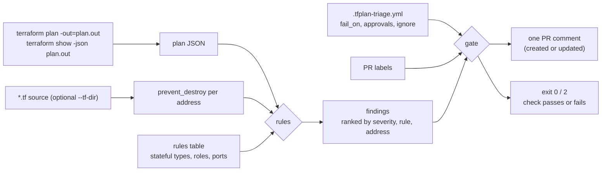

# tfplan-triage

A pull-request reviewer for Terraform and OpenTofu plans. It reads `terraform show -json` output and tells the reviewer the few things that matter, ranked by blast radius: which databases, buckets, disks and keys get destroyed or replaced (and which attribute forces it), which permissions widen, what becomes reachable from the internet, what changed outside Terraform, and which stateful resources have no deletion protection. Everything else is collapsed.

It is a single Go binary and a GitHub Action. It runs offline on the plan file: no cloud credentials, no SaaS, no LLM.

## The problem

A 300-line plan where one line says `# forces replacement` on a database looks almost the same as a plan that only changes tags. Reviewers skim, CI is green, and the apply does exactly what the plan said.

- In February 2026, a `terraform destroy` run with the wrong state file removed the production VPC, ECS cluster and RDS database behind the DataTalks.Club course platform, along with the database's automated snapshots. AWS support recovered a snapshot 24 hours later. The author's fixes were deletion protection in Terraform and in AWS, backups outside Terraform's lifecycle, and reviewing every plan by hand: [How I Dropped Our Production Database](https://alexeyondata.substack.com/p/how-i-dropped-our-production-database) (Alexey Grigorev).
- [terraform-forces-replacement](https://github.com/CaptainChemist/terraform-forces-replacement) reproduces the quieter version: turning on encryption for an existing Aurora cluster cannot be done in place, so Terraform replaces the cluster, and a plan that passes CI deletes every row. Its conclusion is the point of this tool: replacing a spot worker and replacing a database print the same sentence, and telling them apart means knowing which resources hold state.

The plan JSON already contains what a reviewer needs (`actions`, `replace_paths`, `before`/`after`, `resource_drift`). It just isn't presented that way.

## What it reports

| Rule | Severity | What it catches |
|---|---|---|
| `destroy-stateful` | critical (high for caches, queues, streams, addresses) | Delete or replace of a stateful resource: what is lost, the attribute that forces replacement with its before → after value, whether deletion protection will actually stop the apply, and settings that make it worse (`force_destroy`, `skip_final_snapshot`, `delete_automated_backups`) |
| `iam-widening` | critical / high / medium | New wildcard actions or `NotAction`, privilege-escalation actions such as `iam:PassRole` on `*`, public principals, `AdministratorAccess` and other admin policies, `roles/owner`/`roles/editor`, `allUsers` members, Azure `Owner`/`User Access Administrator` at subscription scope |
| `network-exposure` | critical / high / medium | New `0.0.0.0/0`, `::/0`, `*` or `Internet` ingress (critical on SSH, RDP, databases, caches, brokers or all ports), S3 Block Public Access turned off, public ACLs and containers, public database flags, Lambda URLs without auth, new public IPs |
| `protection-removed` | high | `deletion_protection` (or the type's equivalent) switched from on to off |
| `drift` | high / medium / low | Objects changed or deleted outside Terraform (`resource_drift`): a hand-made fix about to be reverted, or a resource about to be recreated empty |
| `unguarded-stateful` | low | A data store created or changed with neither provider deletion protection nor `lifecycle.prevent_destroy` |
| `replace`, `destroy` | low | Replace or delete of stateless resources, with the forcing attribute |

Only new risk is reported. Before and after are compared, so a policy that was already `s3:*` or a security group that already allowed 443 from anywhere is not flagged again on every unrelated edit.

The rules table covers 25 AWS, 22 Google Cloud and 16 Azure stateful resource types, plus IAM and network types on all three. The full generated list is in [docs/rules.md](docs/rules.md). Adding a type is one line in [`internal/triage/catalog.go`](internal/triage/catalog.go), or a few lines of config for your own providers.

## How it works



1. Each entry in `resource_changes` is classified as create, update, replace (`delete,create` or `create,delete`), delete, forget or move.
2. The rules compare `before` and `after` for that resource and look up its type in the rules table. Sensitive values (`before_sensitive`/`after_sensitive`) are never printed or parsed.
3. `resource_drift` entries become drift findings.
4. `lifecycle.prevent_destroy` is not in plan JSON, so `--tf-dir` reads it from the root module and local modules with the HCL parser.
5. Updates that only touch tags, labels or descriptions are grouped and collapsed.
6. The gate fails the check on findings at or above `fail_on`, unless the PR carries a label that a configured approval maps to that rule.

## Usage

### CLI

```sh
go install github.com/gratycodes/tfplan-triage/cmd/tfplan-triage@latest

terraform plan -out=plan.out
terraform show -json plan.out > plan.json
tfplan-triage --tf-dir . plan.json                   # text summary
tfplan-triage --format markdown plan.json > comment.md
tfplan-triage --fail-on critical --labels approved-destroy plan.json; echo $?
```

Exit codes: `0` ok, `1` usage or input error, `2` the gate failed.

| Flag | Meaning |
|---|---|
| `--format text\|markdown\|json` | Output format (default `text`) |
| `--output FILE`, `--json-output FILE` | Write the report to a file; also write JSON |
| `--tf-dir DIR` | Root module, to read `prevent_destroy` |
| `--config FILE` | Policy file (default `.tfplan-triage.yml` when present) |
| `--fail-on LEVEL` | `info`, `low`, `medium`, `high`, `critical` or `none` (default `none`) |
| `--labels a,b` | PR labels to match approvals against |
| `--title NAME` | Plan name such as `prod`; each title gets its own PR comment |

### GitHub Action

```yaml
on:
  pull_request:
    types: [opened, synchronize, reopened, labeled, unlabeled]

permissions:
  contents: read
  pull-requests: write

# after terraform plan + terraform show -json:
- uses: gratycodes/tfplan-triage@v0.1.0
  with:
    plan-json: infra/plan.json
    tf-dir: infra
    config: infra/.tfplan-triage.yml
    title: prod
```

The Action posts one comment per `title` and edits it on every run instead of adding new ones. It reads the PR's labels live, so a reviewer can add `approved-destroy` and re-run the job. Outputs: `critical`, `high`, `blocked`, `missing-labels`, `report-json`. A complete workflow is in [examples/workflow.yml](examples/workflow.yml).

### Policy as code

```yaml
# .tfplan-triage.yml
fail_on: high

approvals:
  - label: approved-destroy
    rules: [destroy-stateful, protection-removed]
  - label: approved-security
    rules: [iam-widening, network-exposure]
    min_severity: high

ignore:
  - address: module.sandbox.*
    rules: [destroy-stateful, unguarded-stateful]

stateful_types:
  acme_ledger:
    kind: database
    loss: every journal entry
    guard_attr: deletion_protection

sensitive_ports:
  8443: internal admin UI
```

A finding at or above `fail_on` blocks the check until the PR has a label from an approval that covers its rule (and severity, if `min_severity` is set). A blocking finding with no matching approval cannot be approved by a label at all. Unknown keys and rule names are errors, so a typo cannot quietly turn a gate off. See [examples/tfplan-triage.yml](examples/tfplan-triage.yml).

To keep the approval meaningful, protect the label: only people who can approve infrastructure changes should be able to add it (for example via a CODEOWNERS review plus a branch ruleset that requires this check).

## Sample comment

This is the Action's comment on the synthetic AWS fixture with the example policy and one label applied (trimmed; the full comment is in [internal/report/testdata/aws-gated.md](internal/report/testdata/aws-gated.md), and the live one is on [PR #1](https://github.com/gratycodes/tfplan-triage/pull/1#issuecomment-6101229194), updated in place after `approved-destroy` was added).

> ### Terraform plan triage
>
> **6 critical, 2 high, 1 medium** · 16 changes (+4 ~7 -/+3 -2)
>
> **Check failed:** 4 findings at `high` or above need approval. After review, add `approved-security` to the PR.
>
> | Severity | What happens | Resource |
> |---|---|---|
> | **critical** | Deletes bucket: all objects | `aws_s3_bucket.scratch` |
> | **critical** | Replaces bucket (forced by `bucket`): all objects | `aws_s3_bucket.statements` |
> | **critical** | Replaces database (forced by `storage_encrypted`): all data and automated backups | `module.ledger_db.aws_db_instance.this` |
> | **critical** | Deletes key: the key material; anything encrypted with it becomes unreadable | `module.ledger_db.aws_kms_key.legacy` |
> | **critical**, blocking | Grants access: attaches AWS managed `AdministratorAccess` | `aws_iam_role_policy_attachment.ci_admin` |
> | **critical**, blocking | Exposes: port 22 (SSH) open to the internet (from `0.0.0.0/0`) | `aws_vpc_security_group_ingress_rule.ssh_debug` |
> | **high**, blocking | Widens access: can grant itself more access (`iam:PassRole` on `*`) (+1 more) | `aws_iam_role_policy.ci_deployer` |
> | **high**, blocking | Exposes: S3 Block Public Access `block_public_policy = false` (+1 more) | `aws_s3_bucket_public_access_block.statements` |
> | medium | Exposes: port 443 open to the internet (from `0.0.0.0/0`) | `aws_vpc_security_group_ingress_rule.https_public` |
>
> **`module.ledger_db.aws_db_instance.this`** (critical, destroy-stateful, approved by `approved-destroy`)
> - `storage_encrypted`: false → true
> - The old object is destroyed before the new one exists.
> - `skip_final_snapshot = true`: no final snapshot is taken before the database is deleted.
> - `delete_automated_backups = true`: automated backups are deleted with the database (the provider default).
> - `deletion_protection` is off, so the provider will not stop it.
>
> *(collapsed: per-module table, 6 tag-only updates, other changes)*

## Test fixtures

The plans in [testdata/plans](testdata/plans) come from real `terraform` 1.16.5 and `tofu` 1.13.1 runs with pinned providers ([testdata/src/gen.sh](testdata/src/gen.sh)), not hand-written JSON:

- **aws, gcp, azure:** a `base/` config is planned, its planned values are turned into a state file, and the `head/` config is planned against that state with `-refresh=false`. The real provider decides what is updated in place and what is replaced, and fills in `replace_paths`. The plans run behind a dead proxy so any call to a cloud API would fail. Credentials are synthetic. `azurerm` insists on a token, so the script serves an unsigned one from localhost.
- **local:** a real apply with the `local`, `random` and built-in `terraform` providers, a file deleted out of band, then a refreshing plan, so `resource_drift` is real.

All names, accounts and IDs are synthetic. The CI `fixtures` job regenerates every plan and checks the findings still match.

Because the cloud plans do not refresh, they have no drift. Drift on cloud resources (updates, protection turned off by hand) is covered by unit tests with constructed `resource_drift` entries.

## How it compares

| Tool | What it does | Where tfplan-triage differs |
|---|---|---|
| [Checkov](https://www.checkov.io/), [Trivy](https://trivy.dev/) (formerly tfsec) | Misconfiguration scanners with hundreds of policies; both can scan plan JSON | They check the resulting configuration, not the change. They are far broader on misconfiguration (encryption, logging, and so on). They do not tell you that a database is about to be deleted, which attribute forces a replacement, or whether a wildcard is new in this PR. Use them alongside this. |
| [Infracost](https://www.infracost.io/) | Cost of a plan | Different question (money, not risk). |
| [tf-summarize](https://github.com/dineshba/tf-summarize), [tfcmt](https://github.com/suzuki-shunsuke/tfcmt), [terraform-change-pr-commenter](https://github.com/liatrio/terraform-change-pr-commenter) | Summarise or post the plan in the PR; tfcmt also warns and labels when resources are deleted | They make the plan readable. They don't know which resources hold state, IAM or network semantics, or deletion protection, so every delete looks the same. |
| [Atlantis](https://www.runatlantis.io/) policy checks, [Spacelift](https://spacelift.io/) plan policies, OPA/conftest | Run your own Rego policies on the plan | Fully flexible, but you write and maintain the rules. tfplan-triage is opinionated rules that work out of the box, with label approvals built in. It does not run plans or applies. |
| [Overmind](https://overmind.tech/) | SaaS that maps a plan's real blast radius by discovering live dependencies in your cloud | It sees real dependencies; tfplan-triage only sees the plan. "Blast radius" here is a severity heuristic from resource type and change, not a dependency graph. Overmind needs an account and cloud read access; this needs neither. |
| LLM plan reviewers | Send the plan to a model for a risk opinion | Not deterministic, and the plan leaves your CI. These rules are deterministic, unit-tested, and run offline. |

## Limitations

- **Rule-based.** It only knows the resource types, roles and ports in its tables. An unlisted stateful type is reported as a low-severity `destroy`/`replace`, not a critical one, until you add it (one line, or config).
- **No dependency graph.** It doesn't know that deleting a KMS key breaks the ten databases encrypted with it, or that replacing a subnet takes its instances down. Severity comes from the resource itself.
- **IAM is pattern matching, not policy evaluation.** It flags wildcards, escalation actions, admin roles and public principals. It does not evaluate SCPs, permission boundaries, conditions or resource-policy interplay. Policies that are unknown until apply (`after_unknown`) cannot be inspected.
- **Deletion-protection semantics vary.** The "the apply will fail" note follows how the AWS and Google providers enforce `deletion_protection` today. Azure mostly protects through management locks, which are separate resources this tool doesn't correlate.
- **`prevent_destroy` needs `--tf-dir`** and only reads literal values in local modules. Variables and registry/git modules are reported as unknown. `.tf.json` files are not read.
- **Drift needs a refreshing plan.** Plans made with `-refresh=false` have no `resource_drift`.
- **Labels are only as strong as who can add them.** Restrict them, or use required reviews, if the gate is meant to be a control.
- **Re-running on label changes re-plans** in the example workflow. For slow plans, upload `plan.json` as an artifact and run the triage step alone on `labeled` events.
- Large plans: the comment shows at most 25 rows in the table and 60 explained findings; the JSON report has everything.

## Development

```sh
make test       # go vet + go test -race
make lint       # golangci-lint
make golden     # rewrite report golden files and docs/rules.md, then review the diff
make fixtures   # regenerate testdata/plans with terraform and tofu (no credentials)
```

## License

MIT, see [LICENSE](LICENSE).
